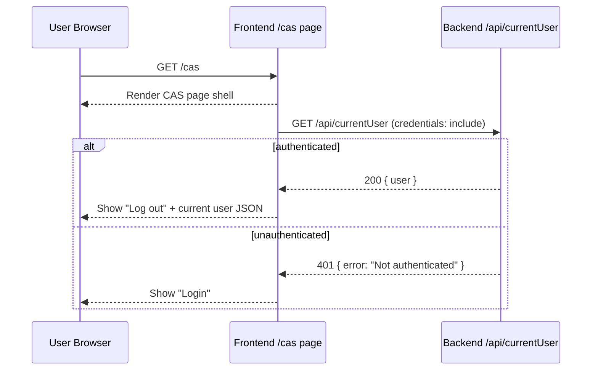
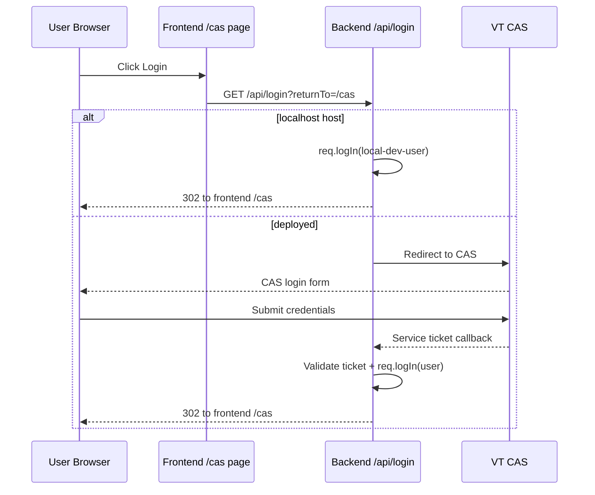
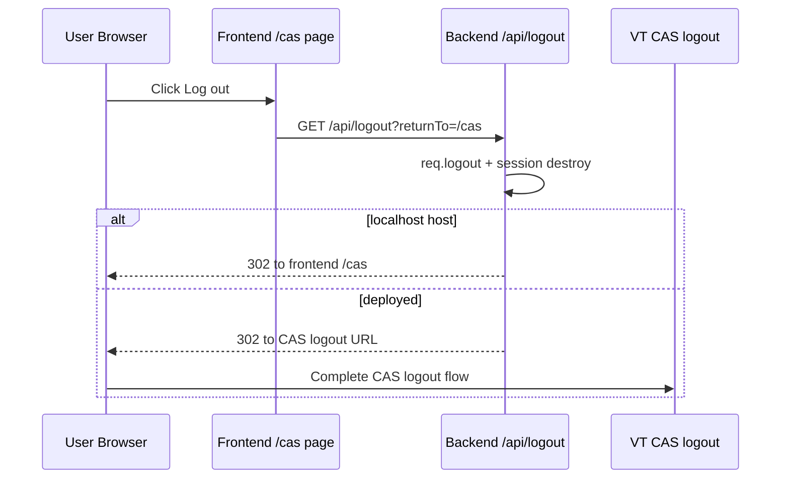

# Auth Documentation

This is the authentication reference for EZSpot.

It explains:
1. how authentication is wired in backend and frontend
2. what `/cas` does end-to-end
3. where auth logic lives in the codebase
4. which `server.ts` lines are most important for auth behavior
5. how local and deployed auth behavior differ

## 1) Auth at a Glance

Auth in this project is session-based and backend-owned:
- Frontend triggers auth actions (`/api/login`, `/api/logout`, `/api/currentUser`).
- Backend performs auth decisions and CAS handshake.
- Passport + `express-session` store authenticated user state in session.
- Frontend reads current session state from `/api/currentUser`.

## 2) `/cas` Page Example Flow

`/cas` is the user-facing auth workflow page:
- frontend route: `/cas`
- it checks current auth state on load
- it presents one button (`Login` or `Log out`)
- it redirects to backend auth endpoints with `returnTo=/cas`

### 2.1 Sequence: `/cas` Page and Session Check

### 2.2 Sequence: Login from `/cas`

### 2.3 Sequence: Logout from `/cas`

## 3) Auth Route Contracts

| Endpoint | Method | Purpose | Typical Success | Typical Failure |
|---|---|---|---|---|
| `/api/login` | GET | Start login flow | `302` redirect | `401` if CAS user resolution fails |
| `/api/logout` | GET | Destroy app session and logout | `302` redirect | `500` if logout callback errors |
| `/api/currentUser` | GET | Session check and user payload | `200` with `{ user }` | `401` when unauthenticated |

## 4) Backend Auth File Map

Auth implementation files:

- `backend/server/auth/authConfig.ts`
  - Reads auth-related environment variables and defaults.
- `backend/server/auth/authUtils.ts`
  - Host detection, safe return path, and redirect URL helpers.
- `backend/server/auth/casStrategy.ts`
  - Passport CAS strategy and CAS profile to app user mapping.
- `backend/server/auth/authLogin.ts`
  - Login entry decision, localhost bypass vs CAS handshake.
- `backend/server/auth/authController.ts`
  - Final response behavior for login/logout/currentUser.
- `backend/server/auth/authStatus.ts`
  - `isAuthenticated` route guard middleware.
- `backend/server/auth/session.d.ts`
  - Session type (`authReturnTo`).
- `backend/server/auth/types.d.ts`
  - `Express.User` type (`pid`, `email`, `name`).
- `backend/server/routes/authRoutes.ts`
  - Route registration for auth endpoints.

## 5) Data Mapping Decisions
Decision based on ER Diagram.

Current app-facing mapping from CAS:
- `pid` <- `profile.user` (forced lowercase)
- `email` <- `profile.attributes.edupersonprincipalname`
- `name` <- `${pid}-name-default`

Fallback behavior:
- If `edupersonprincipalname` is missing/blank, email falls back to `${pid}-email-default@vt.edu`.
- Backend logs an error when that fallback is used.

### 5.1 ER Diagram

The auth data mapping decision in Section 5 maps directly to the left side of this ER diagram.

## 6) Frontend `/cas` Implementation References

- `frontend/src/pages/CasPage.tsx`
  - Loads current user on mount
  - Decides login/logout button mode
  - Redirects to auth endpoints with `returnTo=/cas`
- `frontend/src/components/CasAuthButton.tsx`
  - Reusable auth action button component
- `frontend/src/App.tsx`
  - Registers `/cas` route
