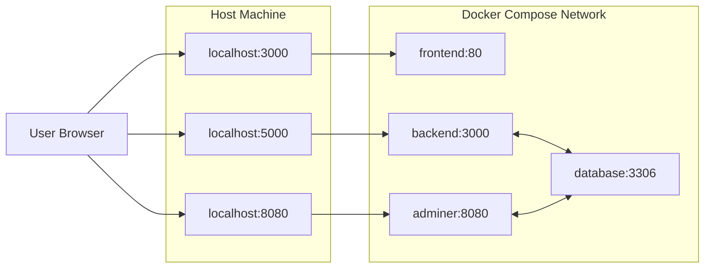
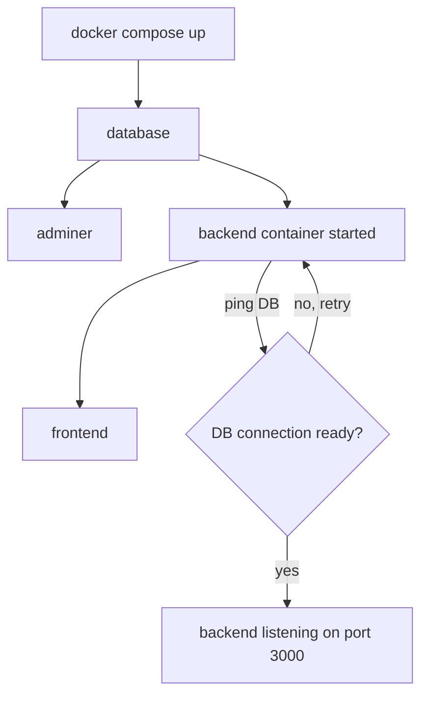
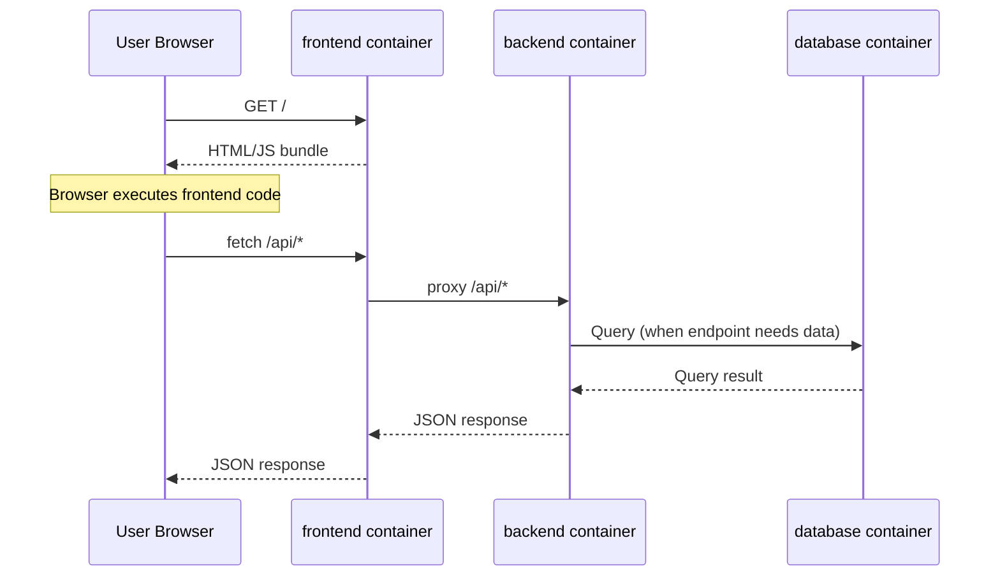
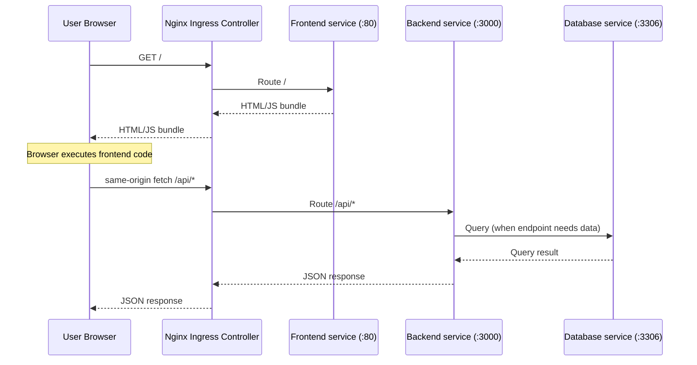

# Docker Documentation

This is the Docker reference for EZSpot.

It explains:
1. how the system is wired
2. how to run it locally
3. how deployed networking differs
4. where Docker files live
5. which commands to use.

## 1) General Design

EZSpot currently runs as four services:
- `frontend`: Nginx serving the built React app.
- `backend`: Node/Express Middleware.
- `database`: MySQL 8.4.

### 1.1 Service Topology (Local Docker)

### 1.2 Port Mapping Reference

| Service | Host port | Container port | Purpose |
|---|---:|---:|---|
| frontend | 3000 | 80 | React UI |
| backend | 5000 | 3000 | Node/Express Middleware |
| database | N/A | 3306 | MySQL 8.4 |

### 1.3 How Containers Talk

- Browser to services: uses host ports (`localhost:*`).
- Container to container: uses service DNS names on compose network (internally).

### 1.4 How Users Interact

- Local dev, URL = localhost 
- Deployed, URL = https://22012s26-ezspot.discovery.cs.vt.edu/
- User opens UI at `http://URL:3000`.
- Frontend browser code calls same-origin backend paths at `/api/...`.

## 2) Docker File Structure Guide

Core files for Docker and runtime behavior:

- `docker-compose.yml`
  - Defines all four services, port mappings, runtime env injection, and the named DB volume.
- `backend/Dockerfile`
  - Multi-stage build for TypeScript backend.
  - Final runtime image installs Python + venv for parser/generator scripts.
- `frontend/Dockerfile`
  - Multi-stage build for React frontend.
  - Final runtime image uses Nginx to serve static assets.
- `tools/docker-compose-tools.bat`
  - Wrapper for `docker-compose up --build -d` and `docker-compose down`.
- `tools/build-push.bat`
  - Builds and pushes frontend/backend images to GitLab container registry.
- `.env.example`
  - Template for required environment variables.

## 3) Local Workflow

### 3.1 Prerequisites

- Docker Desktop installed and running.
- Project root `.env` present and configured (copy from `.env.example` and fill values).

### 3.2 Setup Steps

1. Copy env template to project root.
2. Fill required values in `.env` (DB passwords, session secret, CAS values).
3. Start stack from project root.
   - `./tools/docker-compose-tools.bat up`
4. Confirm endpoints.
   - Frontend: `http://localhost:3000`
   - Same-origin API check through the frontend proxy: `http://localhost:3000/api/hello`
   - Direct backend check: `http://localhost:5000/api/hello`

### 3.3 Data Persistence (Local)

Compose defines a named volume:
- `db-data:/var/lib/mysql`

Relevant commands:
- `docker volume ls`
    - List volumes to see if the volume was properly created.
    - Likely named something like: `capsp26-coe-pdf-extraction-team-e-zspot_db-data`
- `docker volume rm`
    - Delete volumes if you would like to reset MySQL database.

### 3.4 Startup and Readiness

- Compose starts services in dependency order (`depends_on`).
- Declared dependency order in this repo:

### 3.5 Local Request Interaction Chart

Notes:
- Browser code uses the frontend host/port and same-origin `/api/...` paths.
- Frontend Nginx proxies `/api/*` to the backend container.
- Browser code should not use Docker service DNS names like `backend:3000`.

## 4) Deployed Model (Kubernetes-Oriented)

This section showcases how the stack looks when deployed on the VT discovery Kubernetes cluster.

### 4.1 High-Level Deployed Flow

Notes:
- Browser API calls are same-origin path calls (`/api/...`) in deployed mode.
- Ingress handles route mapping.
- Services handle internal communication.

## 5) Common Commands

### 5.1 Team Wrapper Scripts (`tools/`)

| Command | What it does |
|---|---|
| `./tools/docker-compose-tools.bat up` | Runs `docker-compose up --build -d`, starts full stack, prints local URLs. |
| `./tools/docker-compose-tools.bat down` | Stops and removes running compose resources (except named volumes). |
| `./tools/build-push.bat` | Builds frontend/backend images and pushes them to configured GitLab container registry. |

### 5.2 Raw Docker Compose Commands

| Command | What it does |
|---|---|
| `docker compose build` | Builds/rebuilds all images defined in compose. |
| `docker compose up --build -d` | Builds if needed and starts services in detached mode. |
| `docker compose ps` | Shows service status and mapped ports. |
| `docker compose logs -f backend` | Streams backend container logs |
| `docker compose logs -f frontend` | Streams frontend container logs |
| `docker compose down` | Stops and removes containers/network. |
| `docker compose down -v` | Same as down plus removes named volumes (destructive to DB data). |
