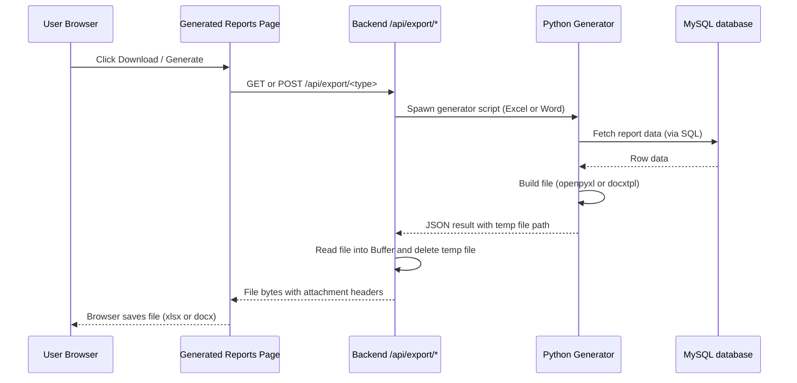

# Document Generation Guide

This guide provides a reference for how EZSpot generates professional reports in Excel and Word formats.

It explains:
1. The unified request flow for exports.
2. The backend orchestration for Python-based generators.
3. The design of the Spreadsheet and Word document generators.
4. How data is shaped and styled for specific report types.

---

## 1) End-to-End Flow

All documents are generated on-demand. When a user requests a download, the backend spawns a specialized Python script to process the database data and build the final file.

### 1.1 High-Level Request Flow

### 1.2 Document Type Mapping

| Type | Format | Endpoint | Python Script |
|---|---|---|---|
| **Prospective** | Excel | `GET /api/export/prospective` | `export_spreadsheet.py` |
| **Top 30** | Excel | `GET /api/export/top30` | `export_spreadsheet.py` |
| **Dean's List** | Word | `POST /api/export/deans-list` | `doc_generator.py` |

---

## 2) Backend Orchestration

The export system is unified using a generic orchestration pattern to ensure consistency and reliable file cleanup.

### 2.1 Router Layer (`spreadsheetRoutes.ts`)
A generic `handleExport` helper manages the common HTTP lifecycle:
- Validates the `reportId` from the query string.
- Orchestrates the call to the service layer.
- Sets appropriate binary headers (`Content-Type`, `Content-Disposition`).
- Streams the resulting buffer to the client.

### 2.2 Service Layer (`spreadsheetService.ts`)
The `executePythonGenerator` helper handles the process lifecycle:
- Spawns the Python process with required arguments.
- Passes input data (like Dean's List form data) via `stdin`.
- Collects `stdout`/`stderr` and parses the JSON result.
- **Automatic Cleanup**: Reads the generated file into memory and immediately deletes the temporary file from disk.

---

## 3) Excel Generation (`export_spreadsheet.py`)

The spreadsheet generator uses `openpyxl` to build formatted workbooks.

### 3.1 Prospective Awards List
A detailed breakdown of all qualifying instructors and their courses.
- **SQL**: Joins `spot_rows` with a subquery of eligible instructors (>= 30 students, >= 3 CRNs, >= 5.2 rating).
- **Layout**: Grouped by instructor. Shows name and classification only once per group.
- **Formulas**: Uses live Excel formulas (`SUM`, `AVERAGE`) for instructor subtotals.
- **Styling**: Distinctive red headers with light orange fill.

### 3.2 Top 30 Awards List
A summary ranking of the highest-rated qualifying instructors.
- **SQL**: Aggregates data at the instructor level and limits to the top 30 rows.
- **Layout**: A single table with row numbers 1-30 in a spacer column.
- **Styling**: Bold headers with yellow fill.

---

## 4) Word Generation (`doc_generator.py`)

The Dean's List generator uses `docxtpl` (which combines `python-docx` and `Jinja2`) to render data into a pre-styled Word template.

### 4.1 Template Logic
The generator maps database data and user-provided form fields to placeholders in `Teaching Dean's List 2024-25.docx`.

- **Instructor List**: Automatically fetches instructors who meet eligibility criteria and inserts them as a formatted list.
- **Academic Year**: Automatically calculates the academic year (e.g., 2024-25) based on the report's date range.
- **User Overrides**: Values like the Dean's name or Course Mean Ratings are taken from the frontend modal.
- **Visual Fallback**: If a field is left blank, it is rendered as a **red bold placeholder** (e.g., **{{DEAN_NAME}}**) to alert the user to manually fill it later.

---

## 5) Real-time Updates

To improve UX, EZSpot uses a custom event system to keep the UI in sync with background processing.

1. **Upload**: When a user uploads a PDF, a "job" is saved to `localStorage`.
2. **Polling**: `GlobalUploadStatus.tsx` polls the backend for that job's status.
3. **Event**: Upon success, it dispatches a window-level `report-processed` event.
4. **Refresh**: Both `GeneratedReportsPage.tsx` and `StatisticsPage.tsx` listen for this event and automatically trigger a re-fetch of their data, making the new report appear instantly.

---

## 6) File Map

- `backend/python/generator/`
  - `export_spreadsheet.py`: Excel build logic.
  - `doc_generator.py`: Word build logic.
  - `sql/`: Isolated SQL queries for all document types.
  - `templates/`: Source Word `.docx` templates.
- `backend/server/routes/spreadsheetRoutes.ts`: HTTP endpoints.
- `backend/server/services/spreadsheetService.ts`: Python bridge.
- `frontend/src/components/DeansListModal.tsx`: User input for Word exports.
