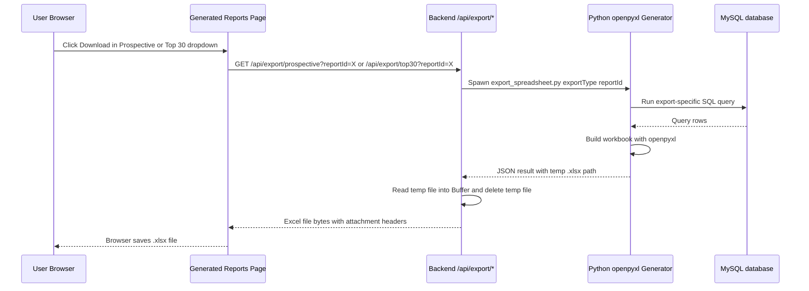
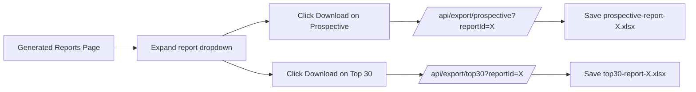
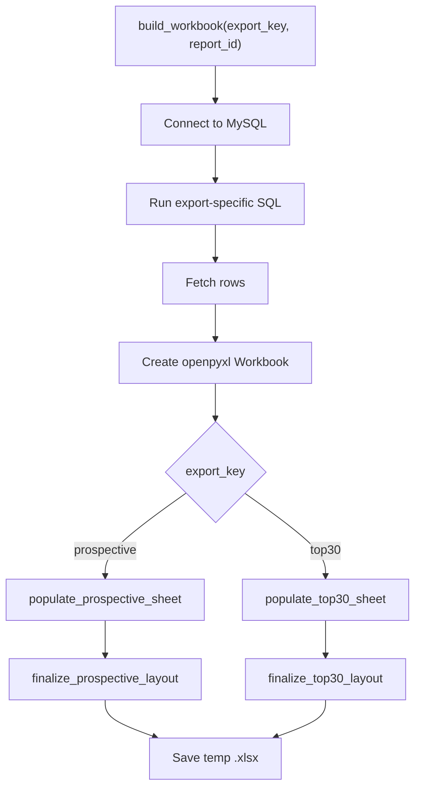

# Spreadsheet Generation Guide

This is the spreadsheet generation reference for EZSpot.

It explains:
1. how the frontend triggers spreadsheet downloads
2. how the backend routes select the export type
3. how the Python generator builds the workbook
4. how the SQL differs for the Prospective and Top 30 exports
5. how the final sheets are shaped and styled.

## 1) End-to-End Flow

Spreadsheet downloads are generated on demand. The browser does not fetch a prebuilt file.

### 1.1 High-Level Request Flow



### 1.2 Frontend Trigger Flow

The generated reports page keeps the download action inside the expanded report row.



## 2) Backend Route Contract

The export routes live under `backend/server/routes/spreadsheetRoutes.ts` and are mounted at `/api` by `backend/server/server.ts`.

| Endpoint | Purpose | Expected Query | Response |
|---|---|---|---|
| `/api/export/prospective` | Generates the Prospective spreadsheet | `reportId=<positive integer>` | Excel attachment |
| `/api/export/top30` | Generates the Top 30 spreadsheet | `reportId=<positive integer>` | Excel attachment |

Each route:
- validates `reportId`
- calls the shared export service
- sets Excel content headers
- returns the workbook bytes as a download response.

### 2.1 Service Bridge

`backend/server/services/spreadsheetService.ts` is the bridge between Node and Python.

It does three things:
- spawns `python backend/python/generator/export_spreadsheet.py <exportType> <reportId>`
- parses the JSON result from the Python script
- reads the temporary `.xlsx` file into memory and deletes the temp file after reading it

## 3) Python Generator Design

The main implementation lives in `backend/python/generator/export_spreadsheet.py`.

### 3.1 Workbook Build Flow



### 3.2 Shared Helpers

The generator uses a few helpers to keep the exports consistent:
- `normalize_cell_value()` uppercases strings and leaves numbers intact.
- `normalize_position_type()` converts `FACUL` to `FACULTY` and `ADJUN` to `ADJUNCT`.
- `apply_base_font()` applies the default sheet font.
- `autosize_columns()` is used for the Top 30 export.

The export metadata is held in a typed Python dataclass, and the SQL text lives in separate files under `backend/python/generator/sql/`.

## 4) Prospective Export

The Prospective export is built for course-level detail grouped by instructor.

### 4.1 SQL Shape

The Prospective query uses a filtered eligible-instructor subquery joined back to `spot_rows`:

```sql
SELECT
    sr.first_name,
    sr.last_name,
    sr.instr_classification,
    sr.instr_rank,
    sr.crn,
    sr.students_enrolled,
    sr.instr_rating_mean
FROM spot_rows sr
INNER JOIN (
    SELECT
        first_name,
        last_name
    FROM spot_rows
    WHERE report_id = %s
    GROUP BY first_name, last_name
    HAVING SUM(COALESCE(students_enrolled, 0)) >= 30
       AND COUNT(DISTINCT crn) >= 3
       AND AVG(instr_rating_mean) >= 5.2
) eligible ON sr.first_name = eligible.first_name
         AND sr.last_name = eligible.last_name
WHERE sr.report_id = %s
ORDER BY sr.last_name ASC, sr.first_name ASC, sr.crn ASC
```

What this means:
- the subquery finds instructors who qualify for the report thresholds
- the outer query returns every course row for those instructors
- rows are ordered by instructor name and CRN so grouped workbook rows stay stable

### 4.2 Sheet Layout

The sheet is formatted as a grouped list per instructor:
- blank A1 cell
- Instructor and Classification shown only on the first row of each instructor group
- `Subject` and `Course Number` remain placeholders for now
- `CRN`, `CRN Enrollment`, and `Instructor Rating Average` carry the course-level values
- subtotal rows use Excel formulas for `SUM` and `AVERAGE`

### 4.3 Subtotal Logic

Each instructor group ends with a subtotal row:
- `CRN Enrollment` uses `=SUM(Hstart:Hend)`
- `Instructor Rating Average` uses `=AVERAGE(Istart:Iend)`

Those subtotal cells are intentionally not bold and use the black-fill/white-text subtotal styling.

### 4.4 Prospective Styling Decisions

Current formatting rules:
- headers use Arial, 12pt, bold, red text
- data uses Calibri, 11pt
- only `Course Number`, `CRN`, `CRN Enrollment`, and `Instructor Rating Average` are center-aligned in the body
- A1 is blank and unformatted
- column widths are explicit for the data columns, with Instructor using auto width plus padding

## 5) Top 30 Export

The Top 30 export is built as a summary ranking of the best instructors in the report.

### 5.1 SQL Shape

The Top 30 query aggregates at the instructor level and limits the output to 30 rows:

```sql
SELECT
    first_name,
    last_name,
    MAX(COALESCE(instr_rank, '')) AS instr_rank,
    MAX(COALESCE(instr_classification, '')) AS instr_classification,
    SUM(COALESCE(students_enrolled, 0)) AS total_students,
    COUNT(DISTINCT crn) AS total_courses,
    ROUND(AVG(instr_rating_mean), 2) AS avg_rating
FROM spot_rows
WHERE report_id = %s
GROUP BY first_name, last_name
HAVING SUM(COALESCE(students_enrolled, 0)) >= 30
   AND COUNT(DISTINCT crn) >= 3
   AND AVG(instr_rating_mean) >= 5.2
ORDER BY avg_rating DESC
LIMIT 30
```

What this means:
- each row represents one instructor
- the query aggregates their teaching load and rating
- only the highest-rated qualifying instructors are returned

### 5.2 Sheet Layout

The Top 30 workbook is a compact summary table:
- column A is a blank spacer with row numbers 1 through 30 beneath it
- Instructor is in column B
- Rank, Position Type, # of Courses Taught, # of Enrollment, and Rating Avg fill columns C through G
- the header row is styled distinctly from the body

### 5.3 Top 30 Styling Decisions

Current formatting rules:
- header text is red with yellow fill
- body uses the default base font
- numeric rating values are formatted to two decimals
- all body columns except the first two are center-aligned
- column A stays at fixed width 8

## 6) Frontend Integration

The frontend integration lives in `frontend/src/pages/GeneratedReportsPage.tsx`.

That page:
- fetches the user’s generated reports from `/api/reports/user/:pid`
- expands each report row into document options
- maps the Prospective button to `/api/export/prospective?reportId=X`
- maps the Top 30 button to `/api/export/top30?reportId=X`
- downloads the returned file using a temporary browser link and `blob` URL

The document types currently map like this:
- `prospective-awards` -> Prospective spreadsheet
- `teaching-awards` -> Top 30 spreadsheet

## 7) File Map

Relevant files for this feature:

- `backend/server/routes/spreadsheetRoutes.ts`
  - HTTP export routes and validation.
- `backend/server/services/spreadsheetService.ts`
  - Python process execution and temp file handling.
- `backend/python/generator/export_spreadsheet.py`
  - SQL queries, workbook generation, styling, and layout rules.
- `frontend/src/pages/GeneratedReportsPage.tsx`
  - Report dropdown UI and download button behavior.
- `frontend/src/App.tsx`
  - Registers the report page route.
- `backend/server/server.ts`
  - Mounts the spreadsheet routes under `/api`.

## 8) Implementation Notes

- The export is generated per request, so the workbook always reflects the current database state.
- The backend uses a temporary file as an interchange step because openpyxl writes files, while the Node route needs a buffer response.
- The Prospective and Top 30 reports intentionally use different layouts because they serve different user needs: detailed course breakdown vs summary ranking.
- The final export behavior is shared across local Docker and deployed environments because both hit the same `/api/export/*` route contracts.